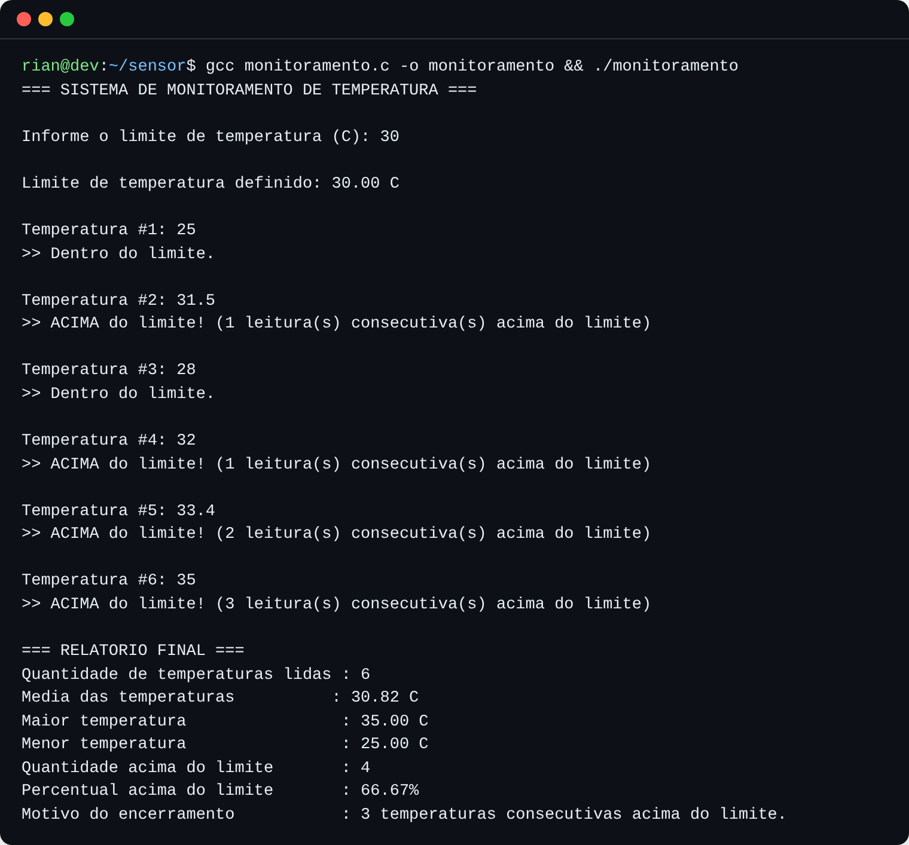

# Sistema de Monitoramento de Temperatura em C


> Projeto acadêmico do **2º semestre de 2026** — Engenharia de Software, UDF.

## Visão geral

Simula um **sensor de temperatura** que faz leituras sucessivas e as compara a um limite definido pelo usuário. O monitoramento é encerrado automaticamente quando ocorrem **3 leituras consecutivas acima do limite**, e então é exibido um relatório com média, máxima, mínima e percentual acima do limite. O problema resolvido é a detecção automática de superaquecimento persistente (e não de picos isolados), com validação robusta de entradas inválidas.

## Tecnologias utilizadas

- **Linguagem C (C99)** — biblioteca `stdio.h`
- Estruturas de repetição `while` e `do...while`, validação de entrada com `scanf` e limpeza de buffer
- **GCC** para compilação · **Git/GitHub** para versionamento

## Como executar

```bash
git clone https://github.com/rian-ribeiro-dev/monitoramento-temperatura-c.git
cd monitoramento-temperatura-c
gcc -Wall -o monitoramento "Sensor de Temperatura em C/monitoramento.c"
./monitoramento
```

No Windows: `gcc -Wall -o monitoramento.exe "Sensor de Temperatura em C/monitoramento.c"` e depois `monitoramento.exe`.
Também é possível colar o código no [OnlineGDB](https://www.onlinegdb.com/) e executar com a linguagem **C**.

## Demonstração

Exemplo com limite de 30 °C — o programa encerra após três leituras seguidas acima do limite:



## 1. Identificação

- **Nome do aluno:** Rian do Nascimento Ribeiro
- **Disciplina:** Algoritmos e Pensamento Computacional
- **Professora:** Profa. Karla Sartin
- **Título do projeto:** Sistema de Monitoramento de Temperatura em C

## 2. Objetivo

O programa simula um sensor que realiza leituras sucessivas de temperatura e as compara
com um limite definido pelo usuário. O objetivo é identificar automaticamente sequências
de temperaturas consecutivas acima desse limite e encerrar o monitoramento assim que três
leituras consecutivas ultrapassarem o limite, apresentando em seguida um relatório com as
estatísticas do período monitorado (quantidade de leituras, média, maior, menor,
quantidade acima do limite e percentual acima do limite).

## 3. Funcionamento do programa

- **Definição do limite:** o limite de temperatura é digitado pelo usuário no início da
  execução e validado antes de o monitoramento começar.
- **Leituras:** a cada iteração do laço principal, o programa solicita uma nova
  temperatura ao usuário (simulando a leitura de um sensor).
- **Entradas inválidas:** toda entrada (limite ou temperatura) é lida com `scanf("%f", ...)`.
  Se o valor digitado não for numérico, `scanf` retorna `0`, o programa exibe uma mensagem
  de erro, limpa o restante do buffer de entrada (função `limparBufferEntrada`) e solicita
  o valor novamente, sem avançar a lógica do monitoramento.
- **Identificação de temperatura acima do limite:** a cada leitura válida, o valor lido é
  comparado com o limite (`temperatura > limite`).
- **Contador de consecutividade:** existe uma variável `consecutivasAcima` que é
  incrementada sempre que a leitura está acima do limite e **reiniciada para zero** sempre
  que uma leitura está no limite ou abaixo dele. Isso garante que apenas sequências
  realmente consecutivas provoquem o encerramento.
- **Encerramento:** o monitoramento é encerrado automaticamente quando
  `consecutivasAcima` atinge `3` (constante `MAX_CONSECUTIVAS`). Essa é a única condição
  de encerramento do monitoramento, conforme especificado no desafio.
- **Cálculo dos resultados finais:** durante o monitoramento o programa acumula a soma das
  temperaturas, a maior, a menor e a quantidade de leituras acima do limite. Ao final,
  calcula a média (`soma / totalLeituras`) e o percentual acima do limite
  (`(qtdAcimaLimite / totalLeituras) * 100`), usando aritmética em ponto flutuante para
  evitar divisão inteira.

### Suposição técnica assumida

O enunciado define apenas uma condição de encerramento do monitoramento: três
temperaturas consecutivas acima do limite. Não há, no enunciado, previsão de um comando
de saída manual (por exemplo, digitar um valor sentinela). Por isso, o programa **não**
implementa uma forma alternativa de encerrar o monitoramento — o laço principal só termina
quando a condição das três leituras consecutivas é satisfeita. Essa escolha foi feita para
não introduzir um requisito que não está no enunciado. Como consequência, ao testar o
programa, o usuário deve sempre finalizar a sequência de entradas com três leituras
consecutivas acima do limite para que o relatório final seja exibido.

## 4. Estruturas de repetição utilizadas

- **`do...while`** é usado em três pontos:
  1. Validação do limite de temperatura (`main`), pois o valor precisa ser solicitado pelo
     menos uma vez e a solicitação deve se repetir enquanto a entrada não for numérica.
  2. Validação de cada leitura de temperatura, pelo mesmo motivo.
  3. Dentro de `limparBufferEntrada`, o laço `while` percorre os caracteres restantes do
     buffer até encontrar `'\n'` ou `EOF` — ele só executa quando há caracteres a
     descartar, então é um `while` puro (pode não executar nenhuma vez, ao contrário do
     `do...while`, que roda o corpo pelo menos uma vez).
- **`while`** controla o laço principal de monitoramento (`while (consecutivasAcima <
  MAX_CONSECUTIVAS)`), pois a quantidade de leituras necessárias não é conhecida
  previamente — depende de quando ocorrerem três leituras consecutivas acima do limite.

Nenhuma estrutura `for` é utilizada para controlar o monitoramento ou a validação de
entradas, conforme exigido.

## Estrutura do repositório

```text
.
├── Sensor de Temperatura em C/
│   ├── monitoramento.c   # código-fonte
│   └── README.md         # documentação original da entrega
├── assets/sensor.png     # captura de tela da execução
├── .gitignore
├── LICENSE               # licença MIT
└── README.md
```

## Licença

Distribuído sob a licença **MIT**. Veja o arquivo [LICENSE](LICENSE).
